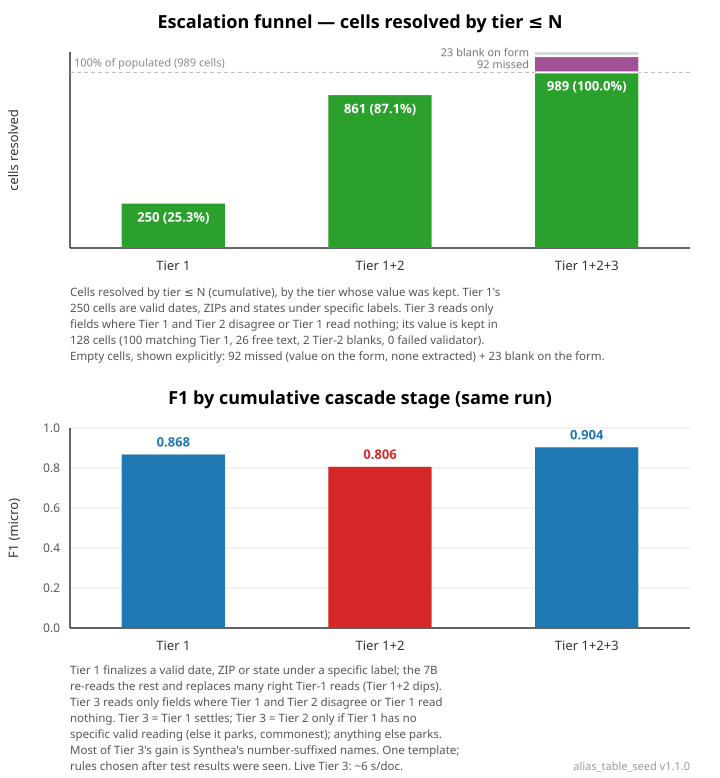
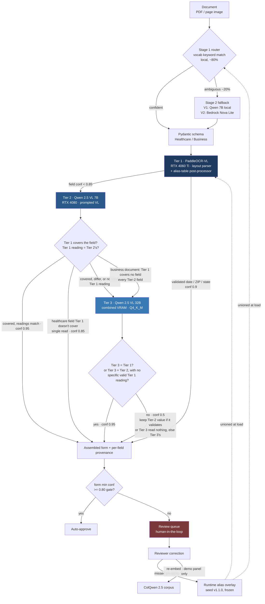
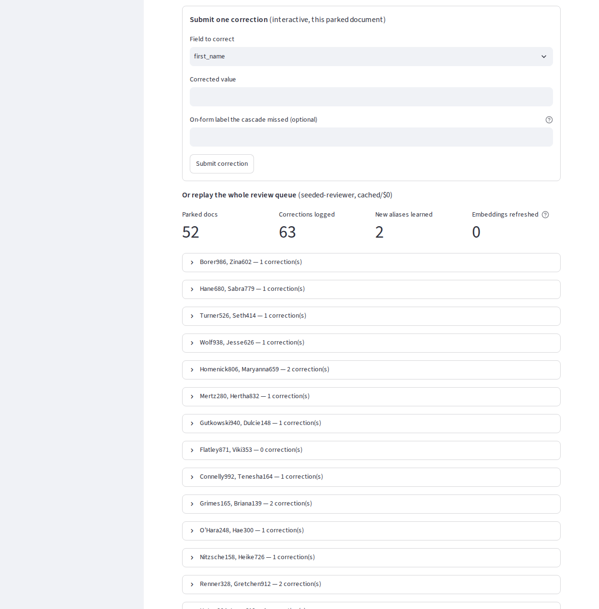
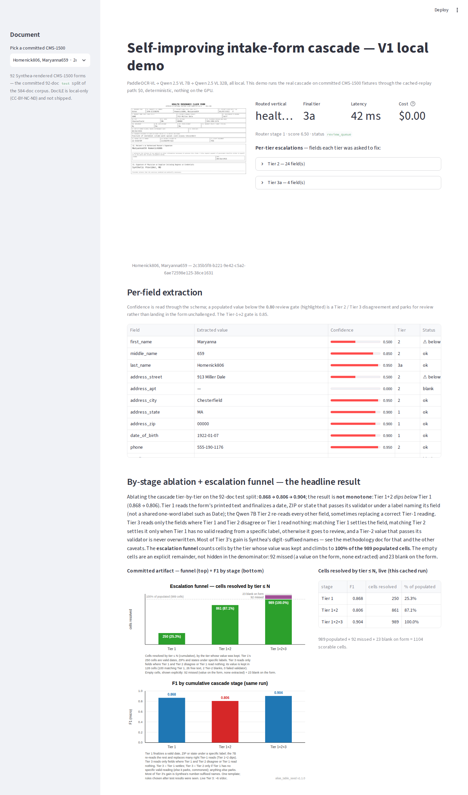

# intake-form-ai-pipeline

> ✅ **V1 complete** — a self-improving intake-form extraction pipeline that runs end-to-end, locally, on consumer GPUs: measured on a 92-document held-out test split, $0/1K inference, no cloud. *Last updated 2026-05-21.*

## What it is

Forms come in as PDFs or page images — healthcare patient intake (CMS-1500), business documents (invoices, POs) — and validated, typed JSON comes out. A three-tier extraction cascade starts every field at a layout parser, sends the ones it can't settle to a 7B vision-language model, and has a 32B model read only the fields where the layout parser and the 7B disagree: where two readers agree the field is accepted, and where they don't it goes to a human. Business documents are the exception: the layout parser has no box rules for them, so the 32B re-reads every field the 7B read, and a mismatch goes to a human. Reviewer corrections feed back into an alias table, so later extractions on similar documents resolve at Tier 1 more often. Corrected documents are also embedded with ColQwen 2.5 for a nearest-neighbor panel in the demo; that retrieval does not feed extraction in V1.

V1 runs the entire cascade locally on two GPUs (RTX 4080 + RTX 4060 Ti, 32 GB combined) — no cloud, no deployed URL, $0/1K inference — and is the complete deliverable. The optional V2 enhancement exists for one reason: processing real PHI requires BAA-eligible providers, so V2 would swap the middle and top tiers for BAA-cloud services (Textract Queries, Bedrock) behind the *same* provider Protocol, wire the local tiers to a deployed endpoint, and stand up a public demo. The in-tree Terraform (`infra/terraform/`) and the architecture docs describe that target so it's a credible, scoped enhancement rather than hand-waving — but it is not built and not scheduled.

## The headline result



> **Measured on a 92-document test split**, cached and deterministic ($0): the patient-level-stratified `test` partition of a 584-document local corpus (500 Synthea patients → CMS-1500, rendered 1:1; `train` 394 / `dev` 98 / `test` 92, zero patient leakage). Both panels are the same cascade run. Per-field results on this split were looked at before the Tier 3 rule was chosen, and printed beside dev while the 2026-10-24 rules were chosen, so it is no longer untouched held-out data — see the caveats below.

The interesting part of this project is not that a curve goes up. It's that measurement contradicted the pitch, and the repo reports what it found and what changing it did — including where the gain comes from.

| Cascade stage | End-to-end F1 | What the tier adds |
|---|---|---|
| Tier 1 — PaddleOCR-VL | 0.868 | layout parse + alias-table match; finalizes a date, ZIP or state that passes its validator under a label naming its field |
| + Tier 2 — Qwen 2.5 VL 7B | 0.806 | re-reads every field Tier 1 didn't finalize, and dips: it replaces correct Tier-1 readings |
| + Tier 3 — Qwen 2.5 VL 32B · Q4_K_M, reads only fields Tier 1 and Tier 2 disagree on | **0.904** | +0.098 over Tier 1+2 — see the caveats below |

**What measurement found.** Until 2026-10-16 Tier 3 *regressed* the cascade (0.791 → 0.765). Its confidence signal was a field-type label — every string scored 1.0 and every date 0.5 — so every date fell below the 0.80 gate and went to Tier 3, where the quantized 32B overwrote 29 correct dates. Until 2026-10-24 Tier 1 scored 0.340 and finalized 2 of the 1,104 test cells, though PaddleOCR-VL's text already held the right value for nearly every field: its confidence was the share of a label cell an alias covered, which never reached the 0.85 gate on CMS-1500's long, box-numbered labels, and packed boxes ("LAST, FIRST", date of birth + sex) and MM/DD/YYYY dates were dropped.

**What changed.** Tier 1 now reads the CMS-1500 table properly (a colspan-aware cell grid, labels scored without their box number, packed boxes split, label and value in one cell, MM/DD/YYYY dates, three CMS-1500 box labels added to the alias seed, now v1.1.0), and a date, ZIP or state that passes its validator gets 0.9 and is final at Tier 1 — but only when its label names the field specifically and sits above the value (the one-word labels "Date", "Address" and "Phone", which several fields share, never finalize, and nor does a date stretched in from the box next door): 250 of 1,104 test cells (dates of birth, states, ZIPs), all correct, as are dev's 256. Every other Tier-1 value stays under the gate and goes to Tier 2. Agreement between readers is the confidence signal, and since 2026-10-24 it also decides what Tier 3 reads: where Tier 1's reading of a field it covers matches Tier 2's, the field is accepted (Tier 1 is right on 480 of 482 such test cells, 458 of 458 on dev); where they differ, or Tier 1 read nothing (a Tier-1 reading that fails its own validator, such as a ZIP read as the state, counts as nothing), the field goes to Tier 3; a field Tier 1 doesn't cover keeps Tier 2's single reading at 0.85, except on a business document, where Tier 1 covers no field and Tier 3 re-reads all of them. Tier 3 now reads 3.0 fields per test document (3.7 on dev) instead of every Tier-2 field (~26). Tier 3 matching Tier 1 settles the field. Tier 3 matching Tier 2 settles it only when Tier 1 has no valid reading from a specific label; against a different such Tier-1 reading the field goes to review, and that is the most common reason a field parks. A Tier-1 reading under a generic one-word label ("15. OTHER DATE" matched by "Date") still decides whether Tier 3 reads the field, but never strict-parks it: Tier 3 matching Tier 2 settles it, and it still parks if Tier 2 and Tier 3 disagree. Anything else goes to review too, keeping Tier 2's value if it passes its validator (date range, ZIP, state, phone) or Tier 3 read nothing, and Tier 3's otherwise — so a validated Tier-2 date is never overwritten.

**Read the +0.098 with these caveats.** Most of it is Synthea's digit-suffixed synthetic names. Of the 107 first- and last-name cells the 32B turns from wrong to right, 74 are names the 7B read without their digit suffix (for first names the digits often went into the middle name: "Ramona980" read as "Ramona" + "980"), 6 are names it left blank and 27 are swaps and other misreads; it turns no right name wrong — a synthetic-data effect, not a general one. Street addresses, where the 32B drops apartment suffixes, still give back 5 cells (37 when Tier 3 read every field), and that loss is kept, not patched. The rules were chosen after test-split results had been seen: the 2026-10-16 Tier 3 rule after inspecting test; the 2026-10-24 Tier 1 and routing rules on dev, with the test numbers printed beside dev while they were chosen; and the 2026-10-25 and 2026-10-26 refinements (the specific-and-aligned label gate for finalizing, the stacked-cell label split, a validator-failing or generic-label Tier-1 reading not strict-parking) in answer to a code review that named three test documents and test parked-cell counts. On the 98-doc dev split (the 2026-10-18 readings, one per document) the cascade gives 0.842 → 0.791 → 0.900 — one run, no confidence interval, and no longer an uninspected split.

**What one live run showed (M0, dev split, 2026-10-30).** The replay cache holds full 27-field Tier-3 readings from a 32B that spilled to CPU at Ollama's default 32k context (the 2026-10-18 dev run averaged 91.7 s per document at ~4 tokens/s). Since 2026-10-26 every Tier-3 request pins `num_ctx` 8192, and one live run of the 98 dev documents (`scripts/m0_tier3.py`) measured the result:
- **It fits on the GPUs.** `ollama ps` reports `100% GPU` (31 GB at context 8192); `nvidia-smi` shows 15,157 of 16,376 MiB used on the RTX 4080 and 14,935 of 16,380 MiB on the RTX 4060 Ti.
- **Speed.** A full 27-field read took 20.97 s per document at 19.46 tokens/s; the narrowed read the cascade sends (3.7 fields per document) took 6.17 s at 20.90 tokens/s. The model loaded once (9.6 s).
- **F1 from the live readings** (dev, not the headline): 0.842 → 0.791 → 0.902 with the full reads and → 0.917 with the narrowed reads, against 0.900 from the cache.
- **Narrowed vs full.** A routed field's narrowed reading matches its full reading on 305 of 364 fields (83.8%). The 59 differences are mostly names and streets (first name 26, last name 14, street 9, reason for visit 7, date signed 2, date of birth 1). In 7 of them the full read left the field blank and the narrowed read filled it — in the ones listed, a date put into reason for visit (e.g. "09/30/2025"), which also cuts the true negatives from 27 to 21.

One run, no confidence interval. The committed replay cache and the test-split numbers above are unchanged: test stays the final number.

**Tier 1's 0.868 is flattered by the corpus.** All 584 documents come from one renderer template, so a parser that reads that table well reads every document well; generalization to other CMS-1500 layouts is unmeasured. And PaddleOCR-VL copies Synthea's digit-suffixed names literally ("Ramona980"), which the 7B splits — that is most of why Tier 1+2 dips below Tier 1 (first names: 80 right at Tier 1, 2 after Tier 2). `docs/eval-methodology.md` "By-stage ablation" has the full disclosure and the known limits.

## How it works



A two-stage router classifies the vertical: a deterministic local vocabulary match handles ~80% of documents with no network hop, and only the ambiguous remainder hits an LLM fallback (local Qwen 7B in V1, Bedrock Nova Lite in V2 — one provider swap, identical routing logic above it). The chosen Pydantic schema seeds the cascade.

An in-process Python orchestrator (no state machine in V1; V2 wraps it in Step Functions) runs the tiers. PaddleOCR-VL is a layout parser whose blocks run through an alias-table-driven layout-to-fields post-processor; a date, ZIP or state that passes its validator under a label naming its field (not the shared one-word "Date", "Address" or "Phone") is final at Tier 1 (0.9), and fields below the 0.85 threshold escalate to a prompted Qwen 2.5 VL 7B. Agreement between readers sets the final confidence and decides what Qwen 2.5 VL 32B reads: a field where Tier 1 and Tier 2 match is accepted at 0.95, a field Tier 1 doesn't cover keeps Tier 2's reading at 0.85, and only the rest — 3.0 fields per test document — go to Tier 3. Tier 3 matching Tier 1 settles a field at 0.95, and matching Tier 2 does so only when Tier 1 has no valid reading of it from a specific label; anything else gets 0.5 and keeps the Tier-2 value when it passes its field validator or Tier 3 read nothing, Tier 3's otherwise. On a business document Tier 3 re-reads every Tier-2 field (agreement 0.95, mismatch 0.5). Fields Tier 1 settles never reach the GPU models: 250 of 1,104 test cells. The assembled form's minimum confidence decides auto-approval versus the human review queue. A reviewer's correction writes back with full provenance and appends any missed label phrasing to a runtime alias overlay, so the next similar document resolves earlier. It also re-embeds the document into the ColQwen corpus, which only feeds the demo's nearest-neighbor panel (and is a no-op on the cached path, where no ColQwen embeddings are committed).

The whole system persists to one SQLite file (extracted fields, eval log, ColQwen multivectors), intentionally Aurora-compatible so the V2 migration is a row-copy rather than a redesign. `docs/architecture-deep-dive.md` covers the orchestrator, persistence model, and the optional enhancement's cloud edge.

## Human in the loop

The review queue is the cascade's HITL surface — where any populated field still below the 0.80 confidence gate after Tier 3 is parked rather than silently accepted. **It is populated by design.** A field parks when no two readers agree on it, or when Tier 2 and Tier 3 agree against a valid Tier-1 reading from a specific label. On the cached test split 52 of the 92 documents park (54 of 98 on dev), most often for first name (32 documents), last name (13), reason for visit (10) and street (9). Of the scored cells the cascade accepts, 908 of 919 are right; of the parked ones, 24 of 70 — the queue holds most of the errors. Until 2026-10-24 Tier 3 re-read every field and every document parked (in 90 of 92 over a HIPAA acknowledgment the template doesn't have); until 2026-10-16 a type heuristic parked every date. A non-empty queue is the intended operating point of a cascade built around adjudication, not an error rate to drive to zero.

**Park ≠ fix.** Parking a field for review does *not* change its F1 contribution: a wrong-but-parked value still counts as a false positive against ground truth. This is the deliberate guard against the obvious gaming path — if "sent to review" excused a field from scoring, the headline could be inflated by parking anything the cascade was unsure of. The queue is operational triage layered on top of the metric, never a metric adjustment.

Corrections submitted from the queue flow back through `src/rag/aliases.py`: any on-form label phrasing the cascade missed is appended to a runtime overlay (`src/data/corrections_aliases.json`, gitignored), unioned onto the frozen v1.1.0 seed at load time and taking effect for the *next* extraction. The committed seed is never mutated — the progressive-alias-partition sweep calls `rag.aliases.suppress_overlay()` so the published artifact can't silently drift from accumulated live corrections. `docs/eval-methodology.md` "## Human-in-the-loop review queue" has the full methodology framing.



*This screenshot predates the 2026-10-16 numbers: its replay shows 184 corrections and 1 new alias; the current replay parks 52 documents and logs 63 corrections and 2 new aliases.*

## What's worth a closer look

**The economics.** V1's cost is $0/1K — local inference on owned hardware, where latency is the meaningful metric, not dollars. The cost-routing argument is what the optional BAA-cloud enhancement would realize: BAA-cloud tiers in the middle and top would take the cascade to ~$9.50/1K, ~32× cheaper than putting every field through a single frontier model (~$300/1K at typical densities). V1 is not a prototype waiting on that number — it is complete, and it produces the measured escalation rates that make the projection credible rather than hypothetical.

**The integrity guardrails.** `alias_table_seed.json` is versioned (v1.1.0 since 2026-10-24) and frozen between versions because it's what the Tier-1 F1 series is measured from; live corrections accumulate in a gitignored overlay unioned onto the seed at load time, and the progressive-partition sweep explicitly *suppresses* that overlay so the published chart can never silently drift. The eval harness defaults to cached, deterministic, $0 fixtures with a CI drift-guard on the committed SVG; live provider runs are opt-in behind `EVAL_LIVE`. Phase 9's QLoRA experiment reports a `+0.0000` delta because the manifest leakage guard correctly yields zero non-leaky training pairs at committed scale — the honest result, not a hidden one.

**The consumer-hardware reality.** Tier 3's locked higher-precision plan (a Mungert Q8_0/Q6_K import) turned out infeasible on 31.2 GB of usable VRAM — Q8_0 spills, Q6_K hits an open llama.cpp M-RoPE assert. V1 ships the registry Q4_K_M build, the only configuration that runs, and documents the measured accuracy cost (≈0.77 on a 20-doc cross-vertical check) as a trade-off rather than burying it. `docs/local-development.md` has the full empirical decision.

**HIPAA as a deployment posture.** The V2 provider surface is BAA-eligible by design, so `HIPAA_MODE` is a startup-time assertion plus raised audit verbosity — not a parallel codebase or a provider-routing fork. V1's flag is a no-op (synthetic data only, no cloud routing surface). `docs/hipaa-architecture.md` covers the V2 BAA boundary.

## Running it

```bash
git clone https://github.com/marky224/intake-form-ai-pipeline
cd intake-form-ai-pipeline
just install        # uv sync + pre-commit
just test           # 1152 tests (1133 fast + 19 slow)
just lint           # ruff + ruff-format + black

just demo           # Streamlit on :8501 — real 3-tier cascade over the
                    # 92-doc test split via cached replay. $0, no GPU.
                    # Installs the optional `demo` dependency group
                    # (Streamlit) on first run; `just install` skips it.
```



*This screenshot predates the 2026-10-16 numbers: it shows the old cascade (Tier 3 re-reading 3 fields, type-based 1.000 confidences) and older figures. The numbers in the text are current.*

The demo surfaces, per document: the rendered form, routed vertical and final tier, per-tier escalations, the per-field value/confidence/tier table, the populated review queue, and — as the headline analytics — the **by-stage ablation + escalation funnel** (F1 by cumulative tier, `0.868 → 0.806 → 0.904`, shown beside the *cells-resolved* coverage rising to 100%, both from the same cached run), with the supporting two-stage F1 numbers below it. For live on-GPU inference, `ollama pull qwen2.5vl:7b qwen2.5vl:32b`, install PaddleOCR-VL per `docs/local-development.md`, then `EVAL_LIVE=true just demo`. No cloud calls, no AWS credentials, either way. `just eval` / `by-stage` run the harness and regenerate the CI-drift-guarded SVG; full task list in the `justfile`.

## Project structure

```
intake-form-ai-pipeline/
├── src/                     # installable editable package (uv sync)
│   ├── intake_schemas.py    # Pydantic v2 schemas (canonical artifact)
│   ├── build_alias_seed.py  # regenerates alias_table_seed.json
│   ├── _paths.py            # repo_root() / src_root() — single path resolver
│   ├── cascade/             # provider Protocol, tier1/2/3, orchestrator, router, store
│   │   └── providers/       # tier1_paddleocr_local, tier2_qwen_7b_local, tier3_qwen_32b_local
│   ├── evals/               # F1/latency metrics, manifest, progressive alias partition, by-stage chart
│   ├── rag/                 # ColQwen 2.5 retrieval + correction feedback loop
│   ├── finetune/            # QLoRA text post-corrector (Phase 9 experiment)
│   ├── demo/                # Streamlit: data.py (testable core) + app.py (view)
│   ├── synthetic_data/      # synthea/, render/ (Playwright CMS-1500), docile/
│   ├── tests/               # 1152 tests + fixtures/ (eval-cache, eval-validation, synthea, docile)
│   └── data/                # SQLite v1.db + ColQwen .npy cache (gitignored runtime)
├── alias_table_seed.json    # 469 aliases / 86 records, frozen v1.1.0 (canonical, repo root)
├── scripts/                 # dev tooling (regen fixtures, dual-quant sanity, M0 live Tier-3 run)
├── infra/                   # terraform/ (optional-enhancement target; bootstrap live) + bicep/ (no-deploy parallel)
└── docs/                    # architecture-deep-dive, hipaa-architecture, eval-methodology,
                             #   production-roadmap, local-development
```

Python 3.11+, Pydantic v2, `uv`, pytest, ruff + black, pre-commit from Phase 1. GitHub Actions runs four required checks on every PR — Lint, Test, Secret scan (gitleaks), IaC scan (checkov against the in-tree Terraform).

## Further reading

- **`docs/architecture-deep-dive.md`** — the shipped V1 orchestrator + persistence; the optional enhancement's cloud edge, five-tier routing, Step Functions layout, sequence diagrams
- **`docs/eval-methodology.md`** — F1 computation, partition/leakage discipline, progressive alias partition, the two-stage finding, the by-stage ablation, Phase 8/9 deviations
- **`docs/hipaa-architecture.md`** — *why the optional cloud enhancement exists*: the BAA boundary, three-layer enforcement, the real-PHI swap path
- **`docs/production-roadmap.md`** — the one optional future enhancement (BAA-cloud for real PHI) + considered-not-done items (Qwen3-VL mixed-precision, Spanish, vLLM scale-up, Bedrock adapter import)
- **`docs/local-development.md`** — GPU/Ollama setup, multi-GPU split, the Tier 3 Q4_K_M trade-off, Synthea + DocILE workflows
- **`RATIONALE.md`** — schema design rationale (DataClass enum, ExtractedField wrapper, SignatureCapture, BoundingBox, confidence aggregation)
